# Maplewood website: editor guide

You change the website in **Sanity Studio**:
https://maplewood.sanity.studio. Log in with the account Ovi invited.

Every change starts as a **draft**. Visitors see nothing until you click
**Publish**. You can always look first, and you can always cancel.

## The easy way: click the page

1. In Studio, click **Presentation** at the top.
2. The website opens on the left. Go to the page you want to change.
3. Click the words, picture or button you want to change. Its fields open on
   the right.
4. Change the field. The page on the left shows the change at once.
5. Look at the page. When it is correct, click **Publish** (bottom right).

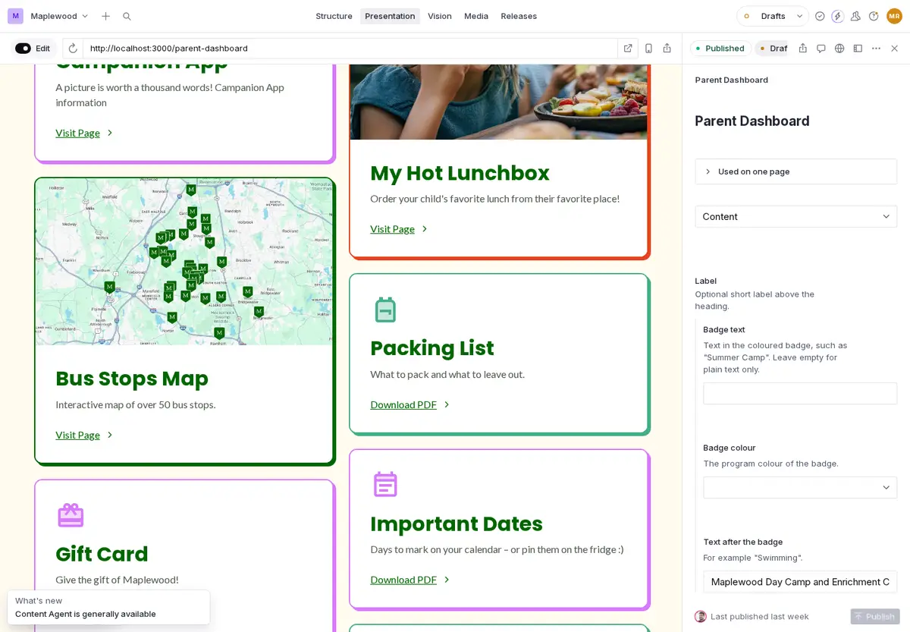

To cancel a change that you did not publish: click **⋯** next to
**Publish**, then **Discard changes**.

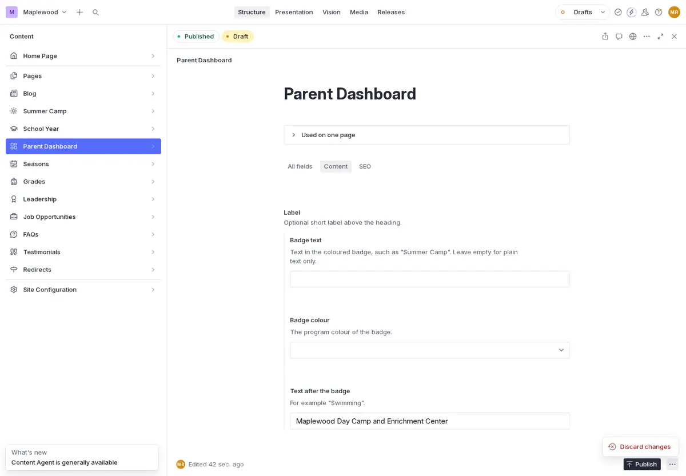

## Replace a PDF on the Parent Dashboard

Use this for the packing list, the important dates and other PDFs.

1. In **Presentation**, go to **Parent Dashboard**. Click the
   **Summer Camp** or **School Year** tab on the page.
2. Click the title of the card, for example **Packing List**.
3. On the right, scroll down to **File**. Click **⋯** next to the file name,
   then **Upload**. Choose the new PDF.

   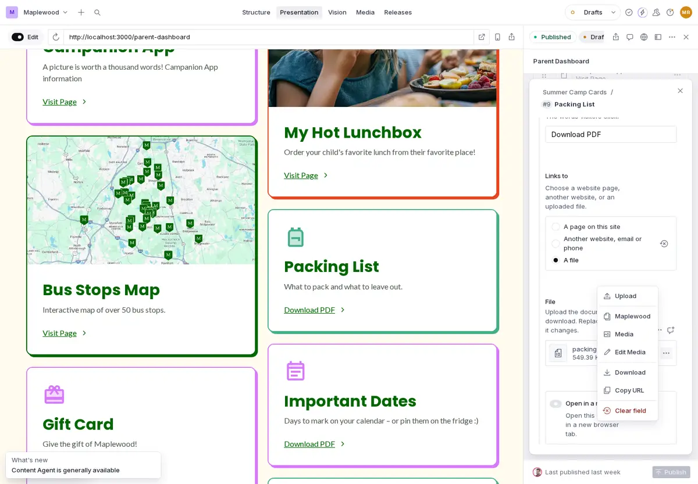

4. The new file name shows under **File**. Click **Download PDF** on the page
   to check it.
5. Click **Publish**.

   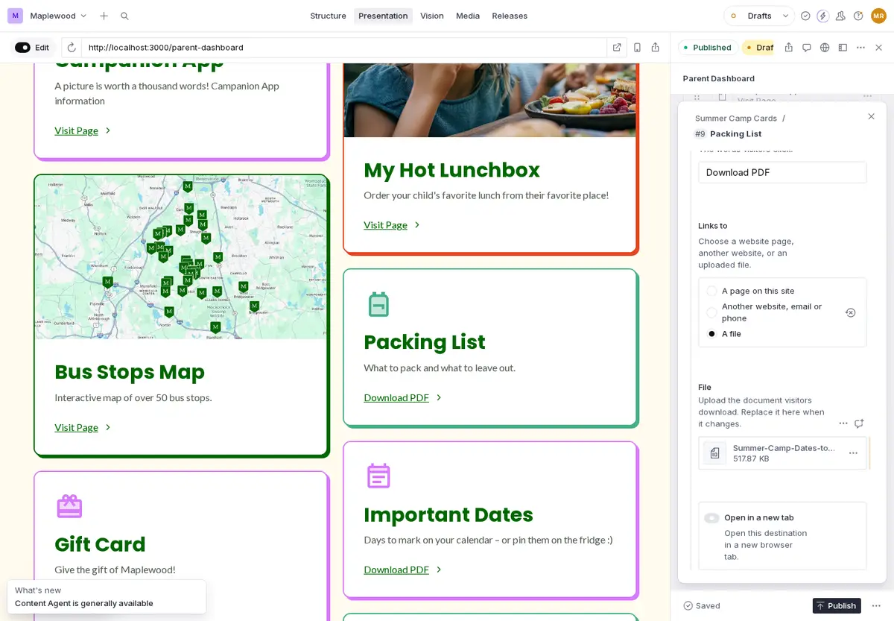

## Change a registration link

1. In **Presentation**, go to the page with the link. Click the card or
   button.
2. On the right, find **Another website, email or phone** and paste the new
   web address. Click the link on the page to check it.
3. Click **Publish**.

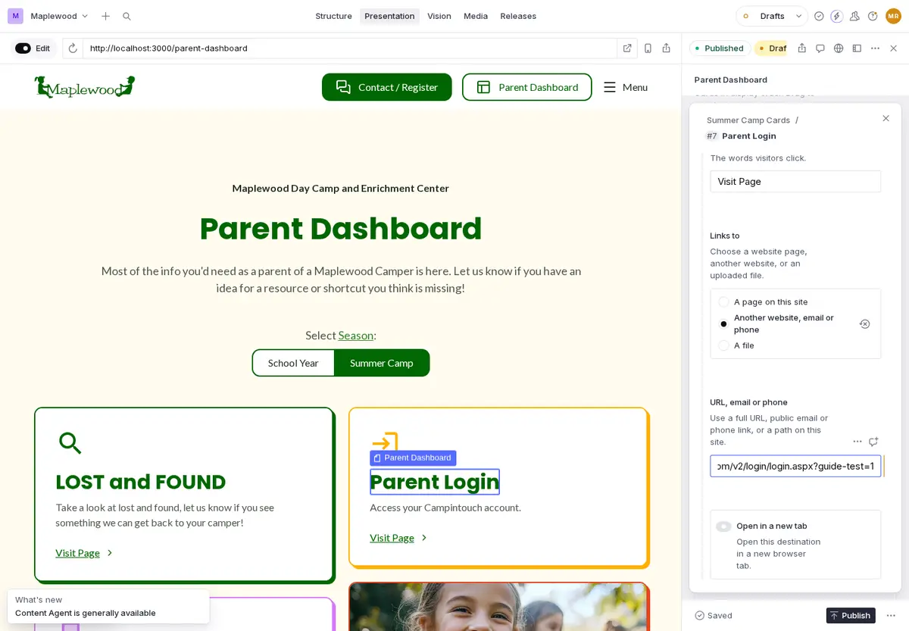

The same registration site is linked from several places. Change every place
that uses the old address:

| Link | Where it is |
| --- | --- |
| CampInTouch (parent login, camper forms) | Parent Dashboard, **Summer Camp** tab; the menu (**Site Configuration → Navigation**, **Contact**); the buttons under the rate tables on **Dates & Rates** |
| Aluvii (Play Center, waiver, birthday parties, gift cards) | Parent Dashboard, **School Year** tab; the menu (**Gift Card**); **Contact & Enrollment** page, School Year cards |
| Brightwheel (preschool application) | **Contact & Enrollment** page, **Preschool Program** card |
| Active.com (classes and vacation weeks) | **Contact & Enrollment** page; the price sections on **Gymnastics**, **Sports Enrichment**, **Flying Solo** and **School-Age Vacation Program** |
| CampInTouch (staff applications) | **Job Opportunities**, each job's apply link |

To find the menu: click **Structure** at the top, then
**Site Configuration → Navigation**.

## Change dates and rates

1. In **Presentation**, go to **Summer Camp → Dates & Rates**.
2. Click a price or a date in the table. The table rows open on the right.
3. Type the new value in its box. Keep the same style, for example `$5,925`.
   Use **Add row** for a new line. Use **⋮** at the end of a row to remove it.
4. Check the table on the page, then click **Publish**.

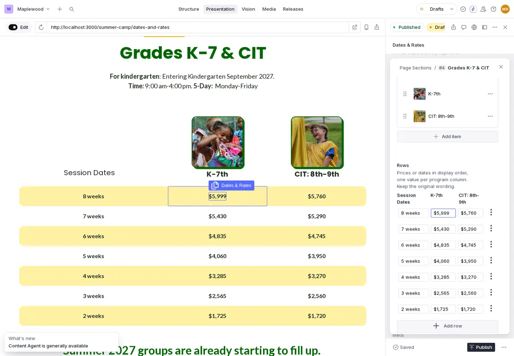

The School Year program pages have their own price sections. Change them the
same way.

## Add a staff member

1. Click **Structure**, then **Summer Camp → Staff Members** (or
   **School Year → Staff Members**).
2. Click **+** at the top of the list.

   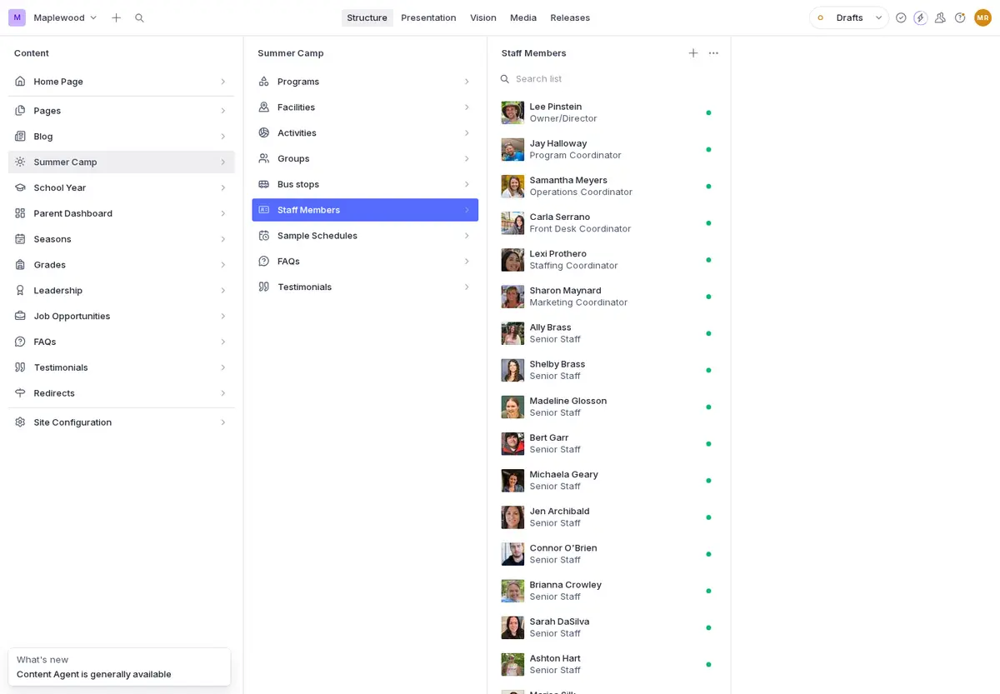

3. Fill in:
   - **Name** and **Role** (their job title);
   - **Program**: choose **Summer Camp** or **School Year**. Do not skip it;
   - **Profile group**: **Roster**;
   - **Image**: click **Upload** and choose the photo. Then write a short
     **Image description**, for example "Counselor smiling at the lake";
   - the other fields if you want: years at Maplewood, badges, biography;
   - **Show on the website** stays on.

   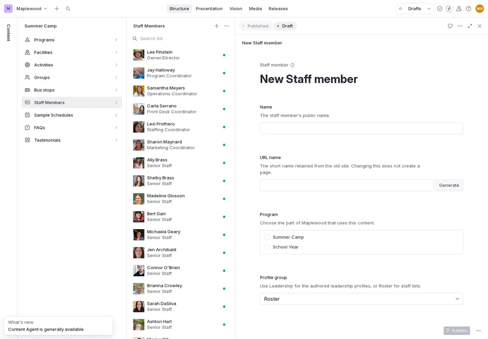

4. Click **Publish**. The person shows on the staff page of that program.

To hide a person without deleting them, turn off **Show on the website**.
For the leadership page, use **Leadership** in the menu.

## Add an FAQ

1. Click **Structure**, then **Summer Camp → FAQs** (or **School Year →
   FAQs**). Click **+**.
2. **Program**: choose **Summer Camp** or **School Year**.
3. **Categories**: click **Add item**, type the topic, and choose it from the
   list. The category decides which page shows the question: for example
   **SC Dates & Rates** shows it on the Dates & Rates page. Every FAQ also
   shows on the **FAQs** page. Add more than one category if the question fits
   several pages.

   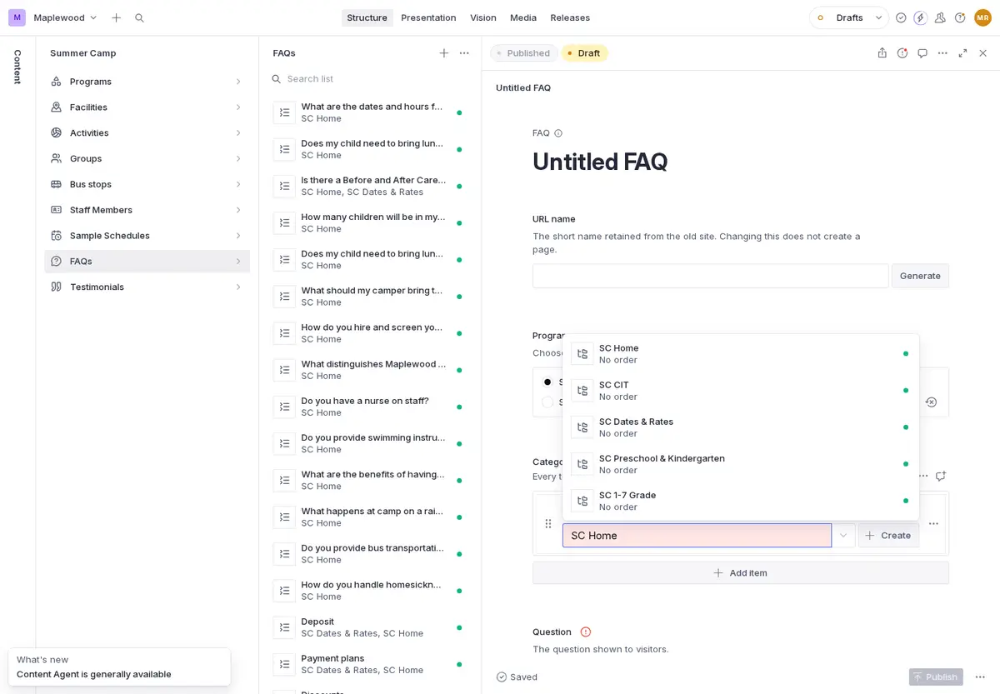

4. Type the **Question** and the **Answer**.
5. Click **Publish**.

   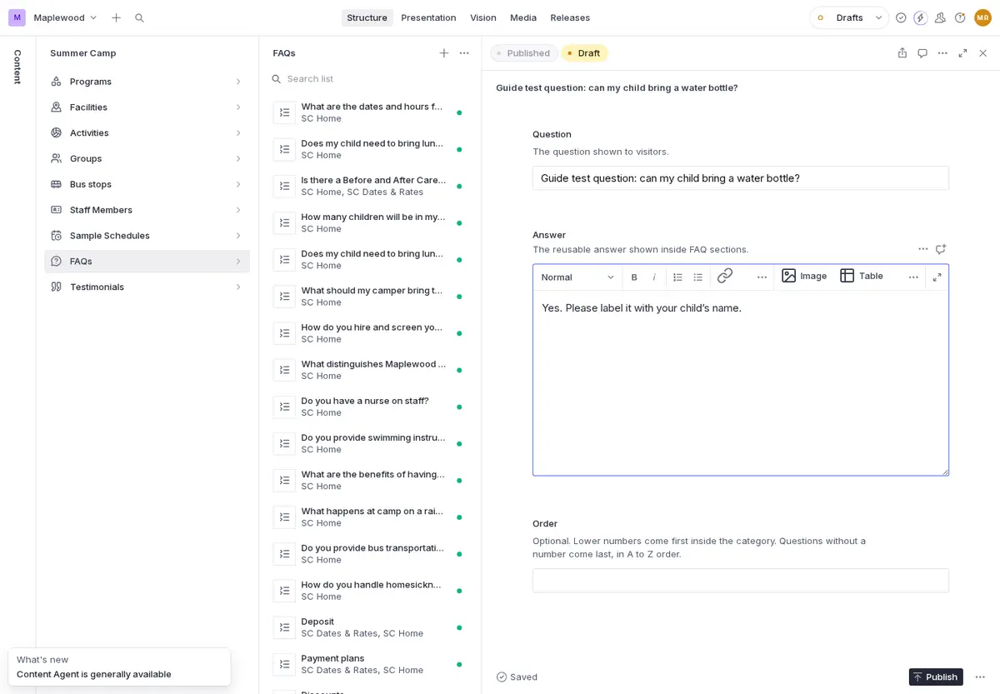

## Publish a news post

1. Click **Structure**, then **Blog → Blog Posts**. Click **+**.
2. Fill in:
   - **Title**;
   - **Slug**: click **Generate**. This makes the post's web address;
   - **Excerpt**: one or two sentences for the News list;
   - **Published At**: the date of the post;
   - **Image** with its **Alternative Text** (a short description);
   - **Category**: type and choose one, for example **Summer Camp**;
   - **Body**: the full text.
3. Click **Publish**. The post shows first on the News page and at
   `/post/` plus its slug.

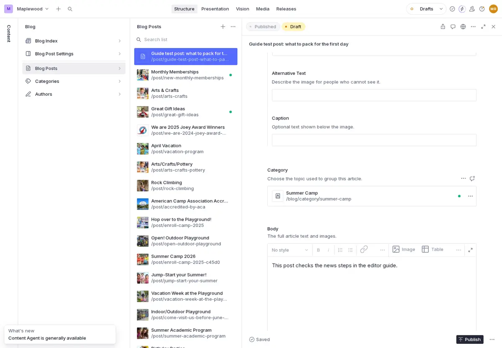

## Replace this summer's group schedules and welcome letters

Each camp group has its own schedule PDF and welcome letter PDF.

1. In **Presentation**, go to **Summer Camp → Summer Group Schedules** (or
   **Summer Camp Welcome Letters**).
2. Click the name of a group, for example **Knights**. The group opens on the
   right.

   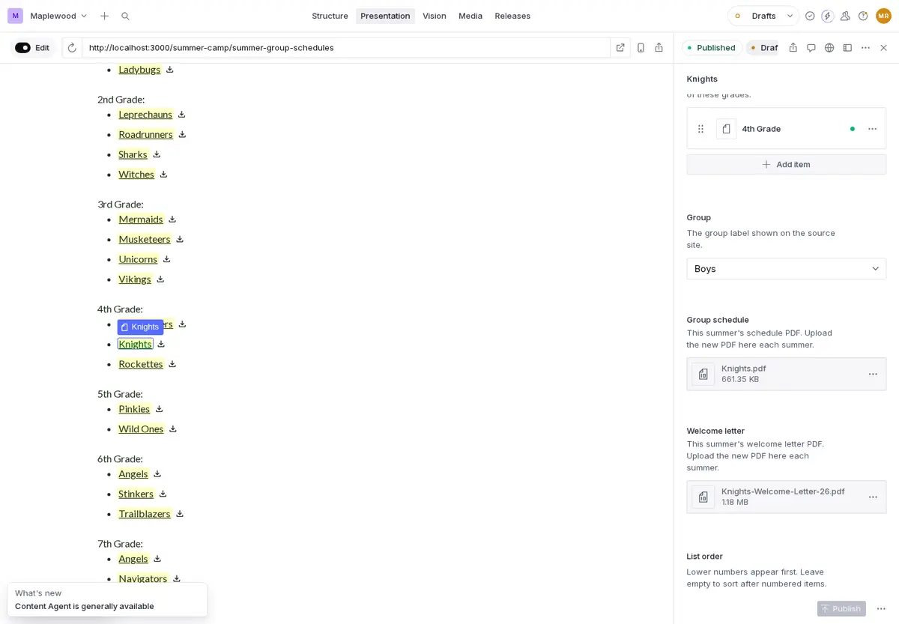

3. Scroll to **Group schedule** (or **Welcome letter**). Click **⋯**, then
   **Upload**, and choose the new PDF.
4. Click the group's name on the page to check the PDF. Then click
   **Publish**.

   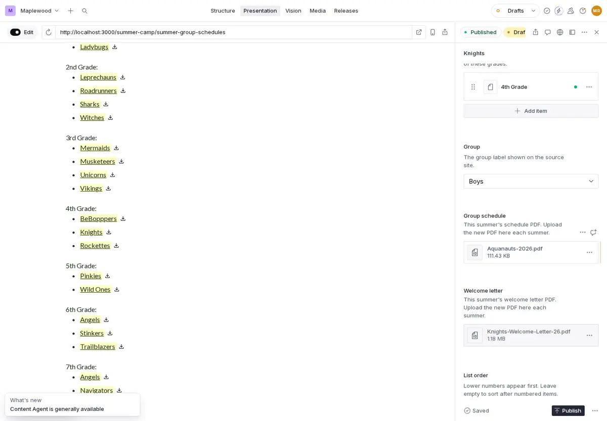

5. Do the same for each group.

The groups are also in **Structure → Summer Camp → Groups**. To hide a group
for a summer, turn off **Show on the website** in the group.

## If something goes wrong

- Not published yet: **⋯** next to **Publish**, then **Discard changes**.
- Published by mistake: click **⋯** at the top right of the document, then
  **History**. Choose the earlier version and restore it. Or ask Ovi.
- A page looks wrong after you publish: wait one minute and reload it. If it
  still looks wrong, ask Ovi.
